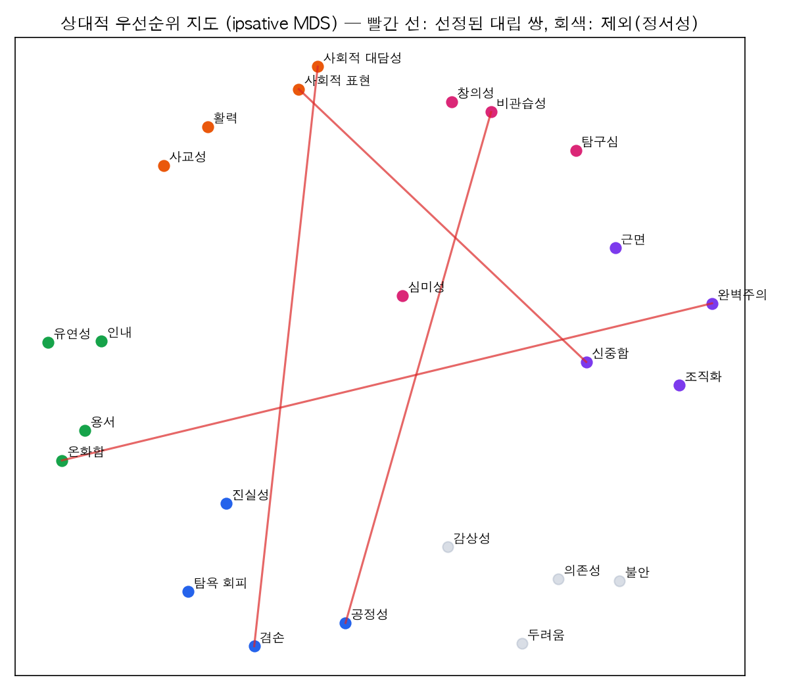

# 평가 기준 재정의 — 분석 결과 (v1.0)

> 프로세스와 사전 고정 규칙: [00-selection-process.md](00-selection-process.md)
> 재현: `cd analysis && uv sync --python 3.12` →
> `uv run --python 3.12 python -I value_conflict/analyze.py ../data/raw` → `select_pairs.py` → `robustness.py` → `export_criteria.py`
> (원자료는 [openpsychometrics.org/_rawdata](https://openpsychometrics.org/_rawdata/)에서 받아 `data/raw/hexaco/`, `data/raw/big5/`에 둔다. 저장소에는 커밋하지 않음)

## 요약

공개 HEXACO 데이터(N=21,270)의 24개 성격 측면 276쌍을 분석해, **사람마다 우선순위가 크게 갈리는 대립 쌍 4개**를 골랐다.
이 4개를 제품의 **가치 축 V1~V4**로 정의하고, 직군·산업군에 따라 그중 하나를 숨겨진 딜레마로 부여한다.

| 축 | 대립 측면 | 관계 | r [95% CI] | 상대 우선순위 r | A 선호 / 동점 / B 선호 | 균형 | 점수 |
|---|---|---|---|---|---|---|---|
| **V1 겸양 ↔ 주도** | 겸손 ↔ 사회적 대담성 | 대립 | −.452 [−.463, −.441] | −.591 | 46% / 21% / 34% | .42 | 15/18 |
| **V2 원칙 ↔ 파격** | 공정성 ↔ 비관습성 | 대립 | −.216 [−.229, −.203] | −.386 | 40% / 28% / 32% | .45 | 15/18 |
| **V3 즉시 공유 ↔ 숙고** | 사회적 표현 ↔ 신중함 | 상대적 우선순위 대립 | −.146 [−.161, −.132] | −.287 | 31% / 25% / 44% | .42 | 15/18 |
| **V4 관용 ↔ 기준** | 온화함 ↔ 완벽주의 | 대립 | −.234 [−.247, −.220] | −.462 | 22% / 28% / 50% | .31 | 12/18 |

- "A 선호"는 두 측면 원점수(1~7) 차이가 0.5점 이상인 사람의 비율이다. 이 값이 **어느 한쪽으로 쏠리지 않아야** 정답이 없는 딜레마가 된다.
- 균형은 min(A, B) / (A + B)이며, 0.5면 완전한 반반이다.
- 사용자가 예로 든 축과는 이렇게 대응된다.
  - "성능 vs 당위성·통제성" → **V2(원칙↔파격)**, **V4(관용↔기준)**
  - "성실성 vs 능력" → 능력 측정치가 없어 검증하지 못했다(가설로 남김).

빨간 선(선정 쌍)은 모두 지도의 반대편을 잇는다. 상대적 우선순위에서 한쪽을 높이면 다른 쪽이 낮아지는 구조라는 뜻이다.

## 1. 데이터 정제

| 단계 | HEXACO N |
|---|---|
| 원자료 | 22,786 |
| 결측 없음 | 22,734 |
| 타당도 문항(지시 이해·성실 응답) ≥ 5 | 21,646 |
| 응답 시간 하위 1% 제외 | 21,270 |
| 동일 응답 연속 ≥ 50% 제외 | 21,270 (해당 없음) |

BIG5: 19,719명 중 19,602명이 남았다(결측·연속 동일 응답·연령 13~90세 기준).

## 2. 측정 품질

- **역문항 추정 검증**: HEXACO 코드북에는 역문항 표시가 없다. 그래서 측면마다 첫 번째 주성분의 부호로 역문항을 추정했다. 같은 방법을 정답 키가 알려진 BIG5에 적용하면 **50/50 문항 일치**해서, 추정 방법이 맞다는 근거로 썼다.
- **신뢰도**: 24개 측면의 ω는 .74(유연성)~.93(인내)이다. 기준(.70) 미달은 없다.
- **요인 구조**:
  - 평행 분석이 6요인을 제안해서 HEXACO 이론과 일치한다.
  - 이론 구조와의 일치도(Tucker φ): H .90 · E .85 · X .92 · A .90 · C .93 · O .91. 정서성(E)만 .90 미만이다.
  - BIG5 교차 확인: 5요인 φ .93~.96이다.
- **문화권 비교**: 동아시아 표본(n=668)과 미국 표본(n=14,118)에서 276쌍 상관 패턴의 유사도는 **r=.985**이고, 평균 절대 차이는 .036이다. 한국 단독 표본은 n=25라 따로 보지 않았다.

## 3. 관계 유형 판정 (276쌍)

| 유형 | 기준 | 쌍 수 | 예 |
|---|---|---|---|
| 대립 | r 95% CI 상한 ≤ −.20 | 30 | 겸손↔사회적 대담성 −.45 |
| 상보 | r 95% CI 하한 ≥ .30 | 49 | 사회적 표현↔사회적 대담성 .77, 온화함↔유연성 .66 |
| 독립 | r 95% CI가 ±.10 안 | 79 | 온화함↔조직화 .003, 공정성↔창의성 −.004 |
| 약한 관계 | 그 밖 | 118 | — |

상대적 우선순위(ipsative) 대립은 71쌍이다. 판정 기준은 응답자별 평균을 뺀 점수로 r 95% CI 상한 ≤ −.20이며, 평균을 빼는 것만으로 생기는 기저값 −.043을 넘어선다.

- **독립 쌍**은 시나리오의 통제 변수로 쓴다. 예를 들어 V4 상황에 '사회적 표현'이 섞여도 V4 판단과 서로 오염되지 않는다(`controls` 필드).
- **상보 쌍**은 통합안이 자연스러운지를 판단하는 참고 자료다.

## 4. 선정 과정

| 단계 | 쌍 수 |
|---|---|
| 후보(대립 30 + ipsative 대립 중 원점수 r CI 상한 < 0) | 61 |
| X1: 정서성(불안·두려움·의존성·감상성) 포함 쌍 제외 | −29 |
| 점수표 적용 | 32 |
| X3(≥ 만점의 60%) · X4(한 측면은 한 쌍에만) | **4** |

### 추가한 규칙과 이유

규칙 X1~X3은 사전 고정 문서에 없던 것으로, 분석 중에 판단해서 추가했다. 이 점을 투명하게 밝혀 둔다.
- **X1 정서성 제외**: 대립 쌍의 상당수가 불안·두려움에서 나왔다. 이 축은 성차가 크고(BIG5 신경성 성별 d = .35) 정신건강과 가깝다. 그래서 채용 딜레마의 극으로 쓰는 것은 윤리적으로 부적절하다고 판단했다.
- **X2 원점수 양의 상관 쌍 제외**: ipsative 대립만 보면 용서↔근면(원점수 r = +.10)처럼 평균을 빼는 과정에서 생긴 인공 대립이 들어온다. 그래서 원점수 r의 95% CI 상한이 0보다 작아야 한다는 조건을 붙였다.
- **X3 최저 점수선**: 6번째 후보는 9/18점으로 근거가 약해서, 만점의 60%(11점) 이상만 선정했다.

### 점수표 상위 (만점 18)

| 쌍 | 관계 | 균형 | 직무 관련성 | 점수 |
|---|---|---|---|---|
| 겸손 ↔ 사회적 대담성 | 대립 | .42 | 1.0 | 15 |
| 공정성 ↔ 비관습성 | 대립 | .45 | 1.5 | 15 |
| 사회적 표현 ↔ 신중함 | ipsative | .42 | 1.5 | 15 |
| 사회적 표현 ↔ 인내 | ipsative | .42 | 1.0 | 13 (사회적 표현 중복으로 제외) |
| 겸손 ↔ 사회적 표현 | 대립 | .37 | 1.0 | 13 (중복) |
| 사교성 ↔ 신중함 | ipsative | .47 | 1.5 | 12.5 (중복) |
| 온화함 ↔ 완벽주의 | 대립 | .31 | 1.0 | 12 |

전체 점수표: `analysis/value_conflict/out/scored_pairs.csv`.

### 직무 관련성 근거 (측면별 0~2, `select_pairs.py`의 `FACET_META`)

| 출처 | 근거 |
|---|---|
| [Pletzer et al. 2019, JVB 112](https://pure.eur.nl/ws/portalfiles/portal/48180213/Pletzer-et-al.-2019-JVB.pdf) | 직장 내 일탈 행동의 가장 강한 예측 요인은 정직-겸손이고, 성실성·원만성이 뒤를 잇는다 |
| [Pletzer et al. 2020, PAID 152](https://repub.eur.nl/pub/123154) | 측면 수준에서 **공정성**의 일탈 설명력이 6개 요인 전체에 근접한다 → 공정성 = 2 |
| [Judge et al. 2013, JAP 98(6)](https://terry.uga.edu/sites/default/files/inline-files/Judge_et_al._2013.pdf) | 성과 예측에서는 요인보다 측면 수준이 중요하다 → 근면·신중함·조직화 = 2 |
| [Mount, Barrick & Stewart 1998, Human Performance](https://Www.Gwern.net/doc/psychology/personality/conscientiousness/1998-mount.pdf) | 팀 직무에서 원만성의 관련이 더 크다 → 유연성 = 2 |
| Barrick & Mount 1991, Personnel Psychology 44(1) | 성실성은 직군 전반의 성과를 일관되게 예측한다 |

### 안정성

| 축 | 전체 r | 동아시아 r | 절반 1 (r, 균형) | 절반 2 (r, 균형) |
|---|---|---|---|---|
| V1 | −.452 | −.477 | −.444, .425 | −.460, .423 |
| V2 | −.216 | −.259 | −.221, .460 | −.210, .438 |
| V3 | −.146 | −.169 | −.140, .414 | −.152, .422 |
| V4 | −.234 | −.259 | −.239, .303 | −.229, .313 |

네 축 모두 동아시아 하위표본에서 같은 방향이고, 오히려 약간 더 강하다. 표본을 반으로 나눠도 ±.02 안에서 재현된다.

## 5. 직군·산업군 → 축 배정 (설계 가설)

축 선택 점수는 `1.5 × 직무 가중 + 산업 가중`이다(각 0~2). 동점이면 직무 가중이 큰 쪽, 그다음 V1→V4 순서로 정한다. 같은 직무·산업이면 누구나 같은 축을 받는다. 가중치와 이유는 `backend/app/criteria.py`의 `SALIENCE`에 있다.

| 직무 \ 산업 | 핀테크 | 헬스케어 | 커머스 | B2B SaaS | 모빌리티 |
|---|---|---|---|---|---|
| 기획·PM | V2 | V2 | V1 | V1 | V1 |
| 개발 | V3 | V3 | V3 | V3 | V3 |
| 디자인 | V4 | V4 | V4 | V4 | V4 |
| 영업·CS | V3 | V3 | V1 | V1 | V3 |
| 데이터·운영 | V2 | V2 | V3 | V2 | V2 |

> 가중치는 전문가 판단이다(데이터가 아님). 직무 가중을 2배로 두면 산업 효과가 사라지고, 1배로 두면 규제 산업이 V2로 쏠렸다(25개 조합 중 11개). 그래서 1.5배를 택했다. 파일럿에서 "이 상황이 내 직무에서 실제로 흔한가"를 설문해 보정한다.

## 6. 시나리오 적용 방식

1. **소통**: 상황을 파악하고 정보를 맞춘다.
2. **조율**: 두 페르소나가 각각 A극과 B극을 대변한다(`pole_of`). 예를 들어 V2에서는 팀장이 원칙을, 도현이 파격을 맡는다.
3. **타협**: 선택지 3개(A극 / B극 / 통합안)가 나타난다. 지원자는 하나를 고르고 이유를 적는다. 선택하지 않으면 최대 4턴까지 이 단계에 머문다.
4. **설득**: 선택에 따라 내용이 달라진다.
   - 한쪽 극을 고르면 **반대 극을 대변하는 페르소나**가 근거를 들어 다시 설득한다.
   - 통합안을 고르면 팀장이 실행 부담(누가·언제·무엇을)을 묻는다.
5. **관찰과 리포트**:
   - 선택(극)은 성향 정보로만 표시한다. 공개 표본 분포 위에 위치를 보여 주고 점수화하지 않는다.
   - 선택의 근거와 상대를 대하는 방식만 기존 C01·C02·C03·C05 행동 근거로 기록한다.
6. **디브리핑**: 종료 후 "이 상황은 V○ 축을 보기 위한 것이었고 정답은 없다"는 설명을 보여 준다.

## 7. 한계

- 표본은 영어권 중심의 온라인 자기선택 표본이다. **관계 구조**(어떤 쌍이 대립하는지)를 판단하는 데만 쓰고, 한국 지원자의 규준이나 점수 기준으로는 쓰지 않는다.
- 성격 측면은 가치(values)와 같은 개념이 아니다. Schwartz 가치 데이터(ESS/WVS)는 회원가입·이용 동의가 필요해 이번에는 분석하지 못했다. 데이터를 확보하면 같은 파이프라인으로 V1~V4가 가치 원형에서도 대립하는지 확인한다.
- 정직-겸손 측면에는 BIG5 대응 요인이 없어 공정성(성차) 점수가 '알 수 없음(1점)'이다. HEXACO 데이터에는 인구통계가 없다.
- "선호 비율"은 문항의 바람직성 차이에 영향을 받는다. V4가 기준 쪽으로 기운 것(50% 대 22%)도 그 영향일 수 있다.
- 시나리오의 선택이 실제 성격 측면과 관련되는지(수렴 타당도)는 아직 검증하지 않았다. 파일럿에서 단축 HEXACO를 함께 받아 확인해야 한다.
